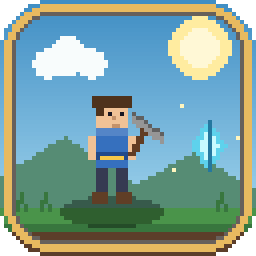

# MINE-LINE QUEST — 2D pixel remake



Пиксельный ремейк текстового квеста **MINE-LINE**. Сюжет, герои, диалоги,
магазин и все экраны 0–12 взяты из оригинальной игры.

## Готовая сборка (Windows)

Готовый `MineLineQuest-2D.exe` лежит в разделе **Releases** репозитория.
Это один файл, Python и pygame внутри устанавливать не нужно.

Если Windows SmartScreen предупреждает о неизвестном издателе, нажмите
«Подробнее» → «Выполнить в любом случае»: файл собран локально без подписи.

## Запуск из исходников

```powershell
cd "D:\vit\New game"
pip install -r requirements.txt
python main.py
```

Нужен Python 3.10+ и pygame 2.6.

## Сборка exe

```powershell
powershell -ExecutionPolicy Bypass -File .\build_exe.ps1
```

Результат: `dist\MineLineQuest-2D.exe` (~27 МБ, один файл).
Иконка генерируется скриптом `tools\make_icon.py`.
Быстрая проверка собранной игры: `MineLineQuest-2D.exe --smoke-test`
(запускается без окна и возвращает код 0).

## Управление

| Клавиши | Действие |
| --- | --- |
| `A` / `D` или `←` / `→` | движение |
| `Пробел` / `W` / `↑` | прыжок |
| `E` | взаимодействие, атака босса |
| `Z` | защита в бою с боссом |
| `I` | инвентарь |
| `Esc` | пауза / закрыть окно |
| `M` | звук вкл/выкл |
| `F11` | полный экран |
| `Q` | выход |

## Что сохранено из оригинала

- Уровни `0`–`12`: лес, мудрый дуб, шахта, пещера руды, штольни,
  кузница пустыни, пирс, море, пирс у шахт, арена босса и финал.
- Дракон Джек, мудрый дуб, торговец, король-гоблин и все их реплики.
- Экономика: дерево, камни, железо, монеты.
- Цены кузницы и требования к снаряжению.
- Руда добывается только киркой; камни на 4-м уровне ломаются рукой.
- Бой с боссом: удар железным мечом, защита на чётных ходах,
  три попадания, смерть → пирс, победа → +500 монет и финал.
- Лодка на 8-м уровне и морской переход 9 → 10.

## Технические детали

- Внутреннее разрешение 480×270, пиксельное масштабирование.
- Вся графика рисуется процедурно в `game/assets.py` — внешних ассетов нет.
- Оригинальные ASCII-карты лежат в `legacy/screens`, спрайты — в `legacy/heroes`
  и используются как источник метаданных (спавн, объекты, переходы).
- Вертикальные шахтные колонны оставлены декоративными: герой проходит
  перед ними, как в 2.5D-сцене. Твёрдый только пол и пара платформ.
